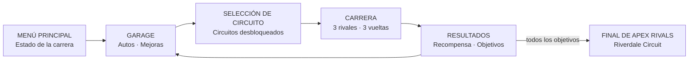
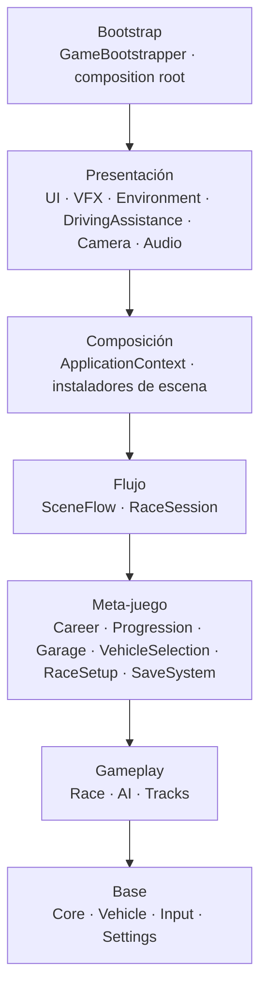

[English](README.md) · **Español**

# 🏎️ Apex Rivals


**Juego de carreras arcade en 3D con carrera profesional, cuatro circuitos, tres rivales con IA por carrera y una gran final.**

---

## Sobre el juego

Apex Rivals es un juego de carreras arcade para PC. La conducción es inmediata y accesible: derrapá en las curvas para cargar el nitro, corré contra tres rivales durante tres vueltas y avanzá en la carrera profesional hasta llegar a la **Final de Apex Rivals**.



Proyecto universitario individual para *Motores de Desarrollo I* (UTN FRBA).

## Características

| Área | Qué incluye la versión 1.0 |
| --- | --- |
| **Conducción** | Física arcade con `WheelCollider`, caja automática, marcha atrás, derrape asistido, estabilidad de chasis, reinicio y recuperación de vuelco |
| **Nitro** | Se carga derrapando; impulso con sonido y efecto de post-procesado propios |
| **Carrera profesional** | Nueve objetivos que desbloquean circuitos, autos y la final, con bonificaciones y porcentaje de avance |
| **Circuitos** | Apex Circuit, Dunes Circuit y Crossover Circuit, más **Riverdale Circuit** (lago y puente) reservado para la final |
| **IA** | Tres rivales por carrera con planificación predictiva de trayectoria, táctica de carrera (adelantar, defender, evitar contactos), derrape y recuperación; perfiles de Rookie a Expert |
| **Garage** | 8 autos para comprar, mejoras de Motor y Manejo, plataforma giratoria dentro de un garage hecho con ProBuilder |
| **Clima** | Cada carrera sortea un pronóstico (soleado, lluvia, nublándose…) que cambia cielo, niebla, iluminación, lluvia y ambiente |
| **Presentación** | Intro previa a la largada con Cinemachine, semáforo animado y confeti al ganar |
| **Línea de conducción** | Guía sobre la pista que se pone verde, amarilla o roja según la velocidad para la curva siguiente |
| **Audio** | Motor sintetizado por auto, neumáticos, impactos, público y lluvia; lista de música con cartel del tema actual; AudioMixer de 4 canales |
| **Gráficos** | Post-procesado URP (bloom, viñeta, motion blur, balance de blancos) y opciones de calidad Baja / Media / Alta, post-procesado y antialiasing |
| **Interfaz** | Menú principal, selección de circuito, Garage, configuración (pantalla, gráficos, audio, controles), HUD con minimapa y posiciones, pausa y resultados |
| **Guardado** | Perfil JSON versionado con archivo temporal y recuperación por backup |
| **Input** | Teclado, mouse y gamepad compatible con Xbox en todas las pantallas |

## Controles

| Acción | Teclado | Gamepad |
| --- | --- | --- |
| Acelerar | `W` / `↑` | Gatillo derecho |
| Frenar / marcha atrás | `S` / `↓` | Gatillo izquierdo |
| Girar | `A` / `D` o `←` / `→` | Stick izquierdo |
| Derrape / freno de mano | `Espacio` | A / Cruz |
| Nitro | `Shift izquierdo` | X / Cuadrado |
| Reiniciar posición del auto | `R` | Y / Triángulo |
| Recuperar auto volcado | `E` | View / Select |
| Pausa | `Esc` | Start |
| Saltear intro | `Enter` / `Espacio` | A / Cruz |
| Navegar la interfaz | Flechas / `WASD` | Stick izquierdo / D-Pad |
| Confirmar / volver | `Enter` / `Esc` | A / B |

La lista completa también está en **Configuración → Controles** dentro del juego.

## Aspectos técnicos

- **Monolito modular:** un assembly (`.asmdef`) por módulo, organizado en capas donde cada módulo solo referencia a los de abajo; el compilador impide dependencias en el sentido contrario.
- **Composition root explícito:** `GameBootstrapper` crea los servicios y los expone mediante `ApplicationContext`; cada escena los recibe a través de `IContentSceneInstaller`.
- **Un mismo contrato de input para jugador e IA:** el auto consume `IDrivingInputProvider`, así el mismo runtime lo maneja el jugador o la IA.
- **Configuración por datos:** autos, circuitos, carrera profesional, recompensas, mejoras, perfiles de IA, clima y efectos son ScriptableObjects.
- **UI Presenter / View:** la lógica de presentación es independiente de uGUI y está cubierta por tests de Edit Mode.
- **Guardado seguro:** esquema versionado, archivo temporal y recuperación por backup.
- **Testing automatizado:** 799 tests de Edit Mode y 125 de Play Mode con Unity Test Framework.

## Arquitectura



| Módulo | Responsabilidad |
| --- | --- |
| `Core` | Contratos compartidos (punto de guardado, validación de largada) |
| `Vehicle` | Física, transmisión, derrape, nitro, telemetría, reinicio y recuperación |
| `Input` | Input del jugador y compuerta de conducción |
| `Settings` | Preferencias de pantalla, gráficos y audio |
| `Race` | Checkpoints, vueltas, posiciones y llegada |
| `AI` | Línea de carrera, planificación, táctica y recuperación |
| `Tracks` | Catálogo de circuitos y desbloqueos |
| `Progression` | Dinero, recompensas y dificultad |
| `Garage` | Mejoras y compra de autos |
| `VehicleSelection` | Catálogo y auto seleccionado |
| `RaceSetup` | Participantes, grilla e instanciación |
| `Career` | Objetivos, desbloqueos y la final |
| `SaveSystem` | Persistencia y recuperación del perfil |
| `SceneFlow` | Estados de la aplicación y navegación de escenas |
| `RaceSession` | Ciclo de vida de la carrera, pausa y resultados |
| `Composition` | Contexto de la aplicación e instaladores de escena |
| `Camera` | Cámara de seguimiento |
| `Audio` | Mixer, síntesis de motores y música |
| `VFX` | Partículas, marcas de neumático y post-procesado del nitro |
| `Environment` | Clima y ambientación de cada circuito |
| `DrivingAssistance` | Línea de conducción dinámica |
| `UI` | Pantallas, presenters, vistas e intro previa a la carrera |
| `Bootstrap` | Inicio de la aplicación y composición de servicios |

## Testing

**799 tests de Edit Mode y 125 de Play Mode** (Unity Test Framework) cubren conducción y transmisión, IA, checkpoints y vueltas, preparación y sesión de carrera, carrera profesional, progresión y recompensas, garage, guardado, flujo de escenas, configuración, selección de autos e interfaz. Los tests de Play Mode corren carreras completas en las escenas reales, incluida una carrera profesional entera hasta la final.

## Cómo ejecutarlo

### Requisitos

- Unity Hub y Unity **6000.3.5f2**
- Windows

### Ejecución local

```bash
git clone https://github.com/EmilianoBazanZapata/ApexRivals.git
```

1. Abrir la carpeta `ApexRivals` desde Unity Hub y dejar que Unity importe los assets y paquetes.
2. Abrir `Assets/ApexRivals/Scenes/Bootstrap.unity`.
3. Presionar **Play**. Bootstrap carga el perfil, la configuración y los servicios antes de abrir el menú principal.

## Build

Orden de escenas: `Bootstrap` → `MainMenu` → `Garage` → `Race` → `RaceDunes` → `RaceSuzuka` → `RaceRiverdale`. `Bootstrap` tiene que quedar primera porque crea los servicios que usan las demás escenas.

## Ramas

| Rama | Propósito |
| --- | --- |
| `main` | Versión actual (1.0) |
| [`release/1.0`](../../tree/release/1.0) | Versión 1.0 con todo su historial de desarrollo (pull requests) |
| [`archive/blocking`](../../tree/archive/blocking) | Historial del prototipo inicial / MVP |

## Documentación

- [Game Design Document](https://docs.google.com/document/d/1bfwXt3fJe0kF9ceK7dGO4p94Dii75I00Dg8r0cDnAX8/edit?tab=t.0)

## Créditos

Diseño y desarrollo: Emiliano Bazán-Zapata. Los escenarios, el garage y los circuitos se construyeron dentro del proyecto con ProBuilder y materiales URP.

Contenido de terceros:

- [Kenney Racing Kit](https://www.kenney.nl) — CC0.
- Modelos de autos (`Assets/ThirdParty/CircuitCars`). <!-- TODO: agregar autor y licencia -->
- Hand Painted Skybox de BD Studios (`Assets/ThirdParty/BDStudios`). <!-- TODO: agregar licencia/enlace -->
- Música: Brimstone Carnage, Hammer of the Wasteland, Juggernaut Uprising, Relentless Damnation, Ritual Velocity, Vantablack Momentum. <!-- TODO: agregar autor y licencia -->

## Licencia

<!-- TODO: agregar un archivo LICENSE e indicar aquí la licencia elegida -->

---

**Binary Suns Studio** · [Sitio web](https://binarysunsstudio.com.ar) · [itch.io](https://emiliano-bazan-zapata.itch.io) · [LinkedIn](https://www.linkedin.com/in/emiliano-bazán-zapata-18705721a)
