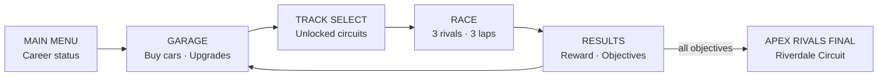
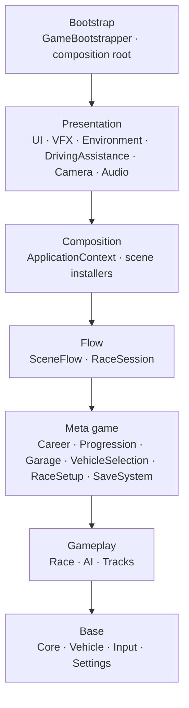
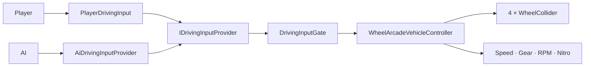

**English** · [Español](README.es.md)

# 🏎️ Apex Rivals


**Arcade 3D racing game with a career mode, four circuits, three AI rivals per race and a final championship race.**

---

## About the game

Apex Rivals is an arcade racing game for PC. Driving is immediate and accessible: drift through the corners to charge your nitro, race three AI rivals over three laps and climb the career until you reach the **Apex Rivals Final**.



Developed as an individual university project for *Motores de Desarrollo I* (UTN FRBA).

## Features

| Area | What version 1.0 includes |
| --- | --- |
| **Driving** | `WheelCollider` arcade physics, automatic gearbox, reverse, assisted drift, chassis stability, reset and flip recovery |
| **Nitro** | Charged by drifting; boost with its own sound and post-processing effect |
| **Career** | Nine objectives that unlock circuits, cars and the final, with bonus rewards and a completion percentage |
| **Circuits** | Apex Circuit, Dunes Circuit and Crossover Circuit, plus **Riverdale Circuit** (lake and bridge) reserved for the final |
| **AI** | Three rivals per race with predictive path planning, racecraft (overtake, defend, avoid contact), drifting and recovery; Rookie to Expert profiles |
| **Garage** | 8 cars to buy, Engine and Handling upgrades, 3D turntable inside a ProBuilder garage hall |
| **Weather** | Each race draws a forecast (sunny, rain, clouding over…) that drives sky, fog, lighting, rain and ambience |
| **Presentation** | Cinemachine pre-race intro over the grid, animated start lights, confetti on victory |
| **Driving line** | On-track guide that turns green, yellow or red depending on the speed for the next corner |
| **Audio** | Engine sound synthesised per car, tyres, impacts, crowd, rain; soundtrack playlist with a "now playing" banner; 4-bus AudioMixer |
| **Graphics** | URP post processing (bloom, vignette, motion blur, white balance) and Low / Medium / High quality, post-processing and anti-aliasing options |
| **UI** | Main Menu, Track Select, Garage, Settings (display, graphics, audio, controls), HUD with minimap and standings, Pause and Results |
| **Save system** | Versioned JSON profile with temporary file and backup recovery |
| **Input** | Keyboard, mouse and Xbox-compatible gamepad across every screen |

## Controls

| Action | Keyboard | Gamepad |
| --- | --- | --- |
| Accelerate | `W` / `↑` | Right trigger |
| Brake / Reverse | `S` / `↓` | Left trigger |
| Steer | `A` / `D` or `←` / `→` | Left stick |
| Drift / Handbrake | `Space` | A / South |
| Nitro | `Left Shift` | X / West |
| Reset car | `R` | Y / North |
| Recover flipped car | `E` | View / Select |
| Pause | `Esc` | Start |
| Skip pre-race intro | `Enter` / `Space` | A / South |
| Navigate UI | Arrows / `WASD` | Left stick / D-Pad |
| Confirm / Back | `Enter` / `Esc` | A / B |

The full list is also in **Settings → Controls** inside the game.

## Technical highlights

- **Modular monolith:** one assembly (`.asmdef`) per module, layered so that every module only references the ones below it; the compiler enforces the dependency direction.
- **Explicit composition root:** `GameBootstrapper` builds the services and exposes them through `ApplicationContext`; each content scene receives them through `IContentSceneInstaller`s.
- **One input contract for player and AI:** the car consumes `IDrivingInputProvider`, so the same vehicle runtime is driven by the player or by the AI.
- **Data-driven:** cars, circuits, career, rewards, upgrades, AI profiles, weather and VFX are ScriptableObject assets.
- **Presenter / View UI:** presentation logic is independent of uGUI and covered by Edit Mode tests.
- **Crash-safe saves:** versioned schema, temporary file and backup recovery.
- **Automated testing:** 799 Edit Mode and 125 Play Mode tests with Unity Test Framework.

## Architecture



| Module | Responsibility |
| --- | --- |
| `Core` | Shared contracts (save checkpoint, race start guard) |
| `Vehicle` | Physics, drivetrain, drift, nitro, telemetry, reset and recovery |
| `Input` | Player input and driving gate |
| `Settings` | Display, graphics and audio preferences |
| `Race` | Checkpoints, laps, positions and finish |
| `AI` | Racing line, path planning, racecraft and recovery |
| `Tracks` | Circuit catalog and unlock data |
| `Progression` | Currency, rewards and difficulty |
| `Garage` | Upgrades and car purchases |
| `VehicleSelection` | Car catalog and selected car |
| `RaceSetup` | Roster, grid and spawning |
| `Career` | Objectives, unlocks and the final |
| `SaveSystem` | Profile persistence and recovery |
| `SceneFlow` | Application states and scene navigation |
| `RaceSession` | Race lifecycle, pause and results |
| `Composition` | Application context and scene installers |
| `Camera` | Follow camera |
| `Audio` | Mixer, engine synthesis, soundtrack |
| `VFX` | Particles, skid marks, nitro post processing |
| `Environment` | Weather and track atmosphere |
| `DrivingAssistance` | Dynamic driving line |
| `UI` | Screens, presenters, views and the pre-race presentation |
| `Bootstrap` | Application start and service composition |

<details>
<summary><b>Vehicle pipeline</b></summary>



</details>

## Testing

**799 Edit Mode and 125 Play Mode tests** (Unity Test Framework) cover driving and drivetrain, AI, checkpoints and laps, race setup and session, career, progression and rewards, garage, save system, scene flow, settings, vehicle selection and UI. Play Mode tests play full races through the real scenes, including a complete career up to the final.

## Getting started

### Requirements

- Unity Hub and Unity **6000.3.5f2**
- Windows

### Run locally

```bash
git clone https://github.com/EmilianoBazanZapata/ApexRivals.git
```

1. Open the `ApexRivals` folder from Unity Hub and let Unity import the assets and packages.
2. Open `Assets/ApexRivals/Scenes/Bootstrap.unity`.
3. Press **Play**. Bootstrap loads the profile, settings and services before opening the Main Menu.

## Build

Scene order: `Bootstrap` → `MainMenu` → `Garage` → `Race` → `RaceDunes` → `RaceSuzuka` → `RaceRiverdale`. `Bootstrap` must stay first because it creates the services the other scenes use.

## Branches

| Branch | Purpose |
| --- | --- |
| `main` | Current version (1.0) |
| [`release/1.0`](../../tree/release/1.0) | Version 1.0 with its full development history (pull requests) |
| [`archive/blocking`](../../tree/archive/blocking) | Early prototype / MVP history |

## Documentation

- [Game Design Document](https://docs.google.com/document/d/1bfwXt3fJe0kF9ceK7dGO4p94Dii75I00Dg8r0cDnAX8/edit?tab=t.0) (Spanish)

## Credits

Design and development by Emiliano Bazán-Zapata. Environments, garage and circuits were built in-project with ProBuilder and URP materials.

Third-party content:

- [Kenney Racing Kit](https://www.kenney.nl) — CC0.
- Car models (`Assets/ThirdParty/CircuitCars`). <!-- TODO: add author and license -->
- Soundtrack: Brimstone Carnage, Hammer of the Wasteland, Juggernaut Uprising, Relentless Damnation, Ritual Velocity, Vantablack Momentum. <!-- TODO: add author and license -->

## License

<!-- TODO: add a LICENSE file and state the chosen license here -->

---

**Binary Suns Studio** · [Website](https://binarysunsstudio.com.ar) · [itch.io](https://emiliano-bazan-zapata.itch.io) · [LinkedIn](https://www.linkedin.com/in/emiliano-bazán-zapata-18705721a)
